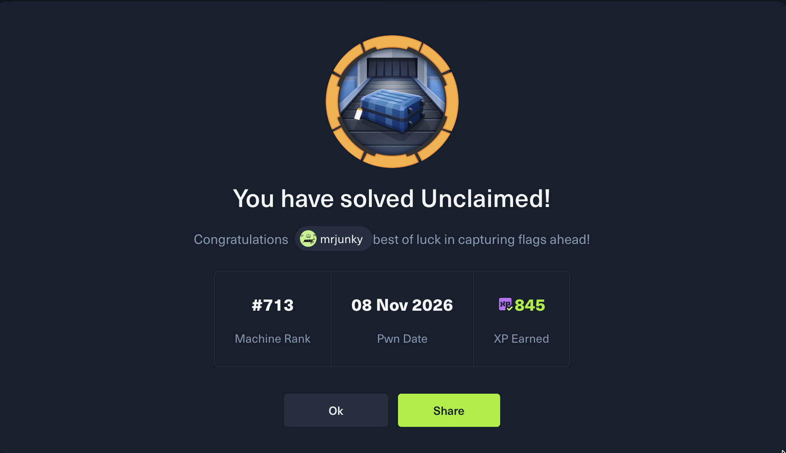

> **Spoiler-free notice:** Unclaimed is still an active Hack The Box machine. This page contains no commands, credentials, flags, attack path, or solution details.

## Unclaimed: Pwned

I completed **Unclaimed** on 8 November 2026. It was a memorable Windows challenge that rewarded careful reasoning across several security boundaries rather than treating every discovered component in isolation.

## Topics explored

The machine brought together several broad areas:

- AI tool security and the risks created when language-model features can reach privileged back-end functions
- Microsoft SQL Server identities, permissions, and execution contexts
- Windows Data Protection API (DPAPI) and responsible credential protection
- SQL Server Agent jobs, service accounts, and automation boundaries
- The security impact of membership in Windows **Backup Operators**

## Lessons learned

### AI refusal is not an authorization boundary

An AI assistant refusing a request is useful behavior, but it is not a security control. Authorization must be enforced by the application and every downstream tool, independently of the model's wording or decision.

### Service identity matters

Database engines, scheduled jobs, proxies, and operating-system processes can run under different identities. Understanding those boundaries is essential when assessing both exposure and impact.

### Automation credentials require strong protection

Credentials used by scheduled services deserve the same governance as interactive administrator accounts: least privilege, rotation, auditing, and secure storage.

### Encryption must be evaluated as a system

DPAPI is an important Windows protection mechanism, but its effectiveness depends on how keys, context, permissions, and surrounding application data are managed.

### Privileges can matter more than account names

An account does not need to be called "Administrator" to possess sensitive capabilities. Effective privileges and group memberships provide a more accurate picture of risk.

## Detailed walkthrough

**Detailed walkthrough will be released after official retirement.**

Until then, I will not publish hints, commands, credentials, flags, screenshots of the attack path, or other details that could spoil the machine.

## Notify me when it is released

<aside class="release-notice" aria-labelledby="release-notice-title">
  
Release alert

  <h3 id="release-notice-title">Get the walkthrough when it drops</h3>
  

    Join the notification list and receive one email when the detailed Unclaimed walkthrough is published after official retirement.
  

  <form class="release-notice__form" action="https://formspree.io/f/mrpqgrky" method="POST">
    

      ✉
      <input id="unclaimed-email" name="email" type="email" autocomplete="email" inputmode="email" aria-label="Email address" placeholder="you@example.com" required>
    

    <input name="article" type="hidden" value="HTB Unclaimed walkthrough">
    <input name="_subject" type="hidden" value="Unclaimed walkthrough notification signup">
    <button type="submit">Notify me →</button>
  </form>
  

    🔒
    One release notification only. No spam, and no walkthrough details before official retirement.
  

</aside>

